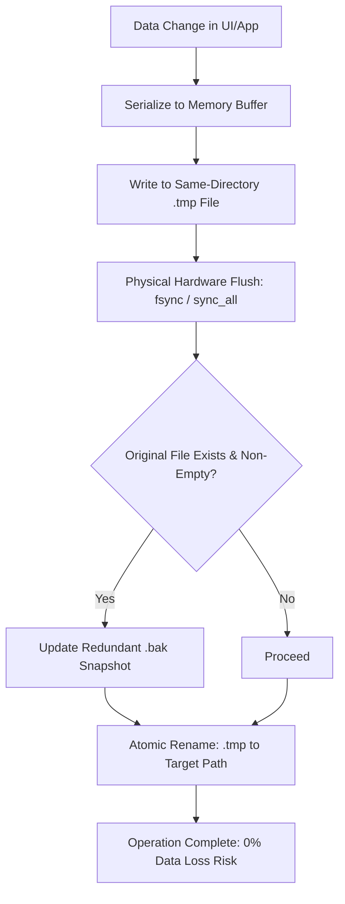

# Rail Reliability & Fault-Tolerance Architecture

This document describes the architectural reliability invariants, data safety mechanisms, and zero-regression protocols enforced in Rail according to the `insane-architect` engineering standard.

---

## 1. Zero-Regression Invariant

All core business logic, user settings, profile boundaries, and keyboard navigation workflows are strictly shielded against regressions:
- **100% Free Path**: No paid services or proprietary telemetry.
- **Strict Profile Isolation**: Cookies, caches, IndexedDB, and local storage are partitioned by dedicated `WebKitNetworkSession` instances.
- **Keyboard-First Paradigm**: All user interactions have deterministically assigned actions and hotkeys.
- **B&W Minimalist Aesthetic**: Black and white canvas with a single blue dot accent.

---

## 2. Transactional Persistence & Self-Healing Engine

File persistence in Rail operates through a transactional storage engine (`src/storage.rs`) designed to withstand sudden OS crashes, power interruptions, and filesystem corruptions:

### Self-Healing on Load
When loading persisted states (`settings.json`, `session.txt`, `shortcuts-customize.json`, `profiles.json`, `history.txt`, `downloads.json`):
1. **Primary Read & Validate**: The primary file is inspected and validated (e.g. valid JSON parsing, non-empty session markers).
2. **Defensive Auto-Recovery**: If the primary file is missing, zero-length, or corrupted, the storage engine inspects the `.bak` replica.
3. **Automated Restoration**: If the `.bak` file satisfies the validation contract, it is atomically restored to the primary file path and loaded seamlessly into memory.
4. **Log Diagnostics**: Diagnostic notices are logged via standard `[rail]` error channels.

---

## 3. Concurrency & Event Loop Confinement

- **Main Thread Purity**: All GTK UI construction, widget manipulation, and WebKit callbacks execute strictly on the GTK main loop.
- **Non-Blocking Background I/O**:
  - History snapshots are sorted and persisted on a dedicated background worker thread (`rail-history`) through epoch-stamped message queues.
  - Cloud backup encryption (AES-256-GCM) and decompression execute in background worker threads.
- **Zero Idle CPU Drain**: Periodic polling loops have been systematically eliminated. Handlers fire only upon real system events, gestures, or debounced dirty flushes.

---

## 4. Clipboard & File System Bridging

- **Web-to-Desktop Native File Drop/Paste**: Linux WebKitGTK natively ignores file lists placed on the clipboard by external file managers (Nautilus, Dolphin, Thunar). Rail intercepts `Ctrl+V` in the capture phase, inspects `text/uri-list` on the native clipboard, and replays synthetic file drop payloads directly into the focused page, resolving paste barriers on web applications.

---

## 5. Verification Matrix

The test suite validates:
- **Storage Resilience**: Deliberately injected corruption triggers successful self-healing from backup.
- **Format Integrity**: TSV and JSON parsers roundtrip properly without loss.
- **Keyboard Maps & Actions**: Every shortcut maps to a registered action ID with collision resolution.
- **Compiler & Linter Standards**: Maintained at **zero warnings** under both `cargo check --release` and `cargo clippy --release`.
